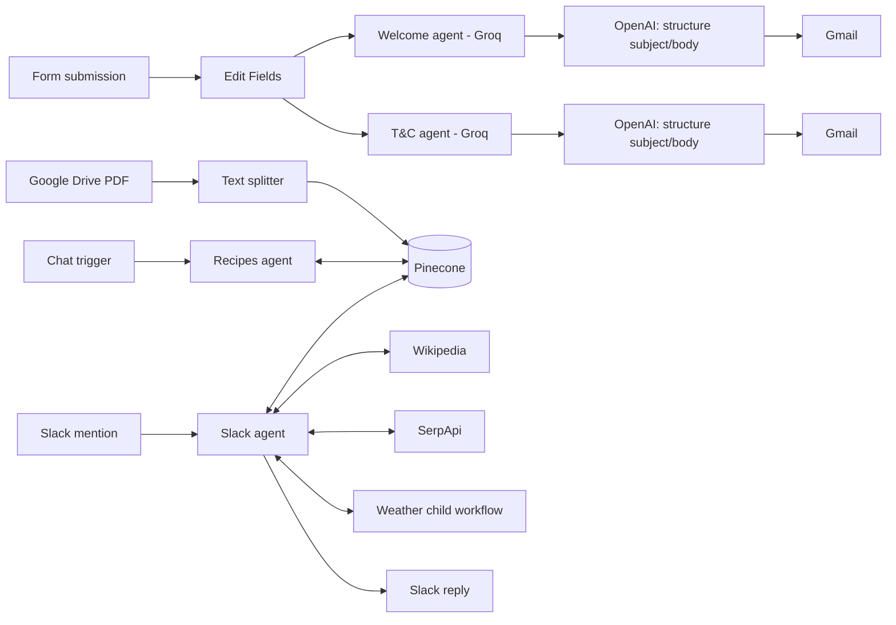

# n8n AI Automation Suite

A collection of AI automations built in [n8n](https://n8n.io): tool-using chat agents, a recipes RAG chatbot on Pinecone, an automated client-onboarding email system, and a multi-tool Slack assistant. All of it lives in one workflow file (73 nodes) split into labelled sections.

> **Status:** learning/portfolio project. Some sections are demos and are not wired to a trigger (see [Known issues](#known-issues)).

## Contents

| Section | What it does | Trigger |
|---|---|---|
| **Wikipedia Agent** | Routes chat input: messages ending in `[agent]` go to an AI Agent with Wikipedia + memory, others go to a Basic LLM Chain | none attached (add a Chat Trigger) |
| **Search Agent** | AI Agent that must call SerpApi (Google) for real-time answers | none attached |
| **Weather Agent** | Agent using OpenWeatherMap and a Gmail tool | none attached |
| **Weather via child workflow** | Agent that calls a separate "Weather" workflow and returns its output verbatim, with a Gmail tool | none attached |
| **Client Onboarding System** | Web form → two parallel LLM agents write a welcome email and a Terms & Conditions email → OpenAI structures subject/body → Gmail sends both to the client | Form Trigger |
| **RAG Pipeline Chatbot** | Ingests a recipes PDF from Google Drive into Pinecone; a chat agent answers only from retrieved recipe content | Manual Trigger (ingest), Chat Trigger (chat) |
| **Slack Chatbot** | Slack mention → agent choosing between Pinecone, Wikipedia, SerpApi and the Weather child workflow, with per-user memory → replies in Slack | Slack Trigger |
| **Training nodes** | Customer Datastore → Edit Fields → If (country = US), plus unconnected LangChain building blocks (Information Extractor, Q&A, Sentiment, Summarisation, Text Classifier) | none |



## Prerequisites

- n8n (cloud or self-hosted, a recent 1.x/2.x release that includes the LangChain nodes)
- Community node **`n8n-nodes-serpapi`** (Settings → Community Nodes)
- Accounts and API keys for the services listed in [`CREDENTIALS.md`](CREDENTIALS.md)
- A Pinecone index named `14-recipes-rag-agent` with **1536 dimensions**
- A separate **Weather child workflow** (not included in the export)

## Setup

1. **Clone the repo**
   ```bash
   git clone https://github.com/<your-username>/n8n-ai-automation-workflows.git
   cd n8n-ai-automation-workflows
   ```
2. **Prepare your secrets**
   ```bash
   cp .env.example .env
   # fill in .env with your own values (it is git-ignored)
   ```
3. **Import the workflow** into n8n: *Workflows → Import from File →* `workflows/ai-automation-suite.json`
4. **Create credentials** in n8n for every entry in [`CREDENTIALS.md`](CREDENTIALS.md) and attach them to the nodes (nodes with a missing credential show a warning).
5. **Replace placeholders** in the workflow: `your-email@example.com`, `sender@example.com`, `YOUR_SLACK_CHANNEL_ID`, `YOUR_GOOGLE_DRIVE_FILE_ID`, `YOUR_WEATHER_CHILD_WORKFLOW_ID`.
6. **Ingest the recipes**: run the *When clicking 'Execute workflow'* trigger once to load the PDF into Pinecone.
7. Test each section with its trigger, then activate the workflow.

> n8n stores credentials encrypted inside its own database and does not auto-load `.env` into node credentials. `.env` is your local reference/secret store; enter the values through the n8n UI, or expose them as environment variables for your n8n instance.

## Repository structure

```
.
├── workflows/
│   └── ai-automation-suite.json   # sanitized n8n export
├── .env.example                   # variable template (safe to commit)
├── CREDENTIALS.md                 # every credential and placeholder required
├── .gitignore
├── LICENSE
└── README.md
```

## Security

- The workflow JSON was **sanitized**: credential IDs, instance ID, webhook IDs, pinned test data, Slack/Drive/workflow IDs and personal email addresses were removed or replaced with placeholders.
- Never commit `.env` or a raw n8n export. If you re-export from n8n, sanitize it before committing.
- If a real key was ever committed or pasted publicly, revoke and rotate it.

## Known issues

- Several sections have no trigger node (Wikipedia, Search, Weather agents), so they cannot run until you add one, e.g. a Chat Trigger.
- The *Basic LLM Chain* has no prompt configured, and the training LangChain nodes (Information Extractor, Q&A, Sentiment, Summarisation, Text Classifier) have no model or input.
- The Wikipedia and Search agents share a system prompt that mentions SerpApi; the Wikipedia agent has no SerpApi tool.
- The Slack agent's system prompt in the export is cut off mid-sentence ("...no tool returns a").
- The onboarding form label is misspelled `Full Nmae`; the Set node depends on it, so fix both together.
- The two `Code in JavaScript` nodes are not connected to any later node (the OpenAI structuring nodes do the work).
- `Question and Answer Chain1` has no trigger or output.
- The RAG chat agent uses a `:free` OpenRouter model, which may be rate-limited.

## License

Released under the [MIT License](LICENSE).
