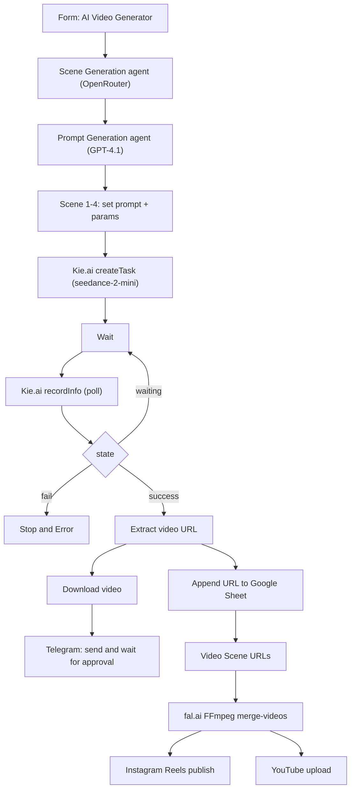
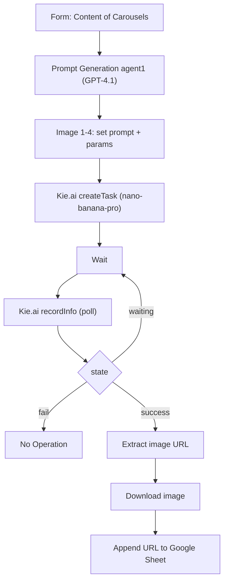

# Content Generation Automation (n8n)


An n8n workflow that turns a short idea into **AI-generated social media content**. Fill in a form and the workflow writes the prompts with LLM agents, generates the media with [Kie.ai](https://kie.ai), asks for your approval on Telegram, and can stitch and publish the result.

It contains two pipelines on one canvas:

| Pipeline | Trigger | Output |
|---|---|---|
| **AI Video** | Form *"AI Video Generator"* | 3-4 scene clips made with **Seedance 2 Mini**, logged to Google Sheets, sent to Telegram for approval, merged with **fal.ai FFmpeg**, then published to Instagram Reels and YouTube |
| **Image Carousel** | Form *"Content of Carousels"* | 4 consistent slides made with **Nano Banana Pro**, with each image URL logged to Google Sheets |

## Features

- **Form-driven input**: video idea, resolution (480p / 720p / 1080p), aspect ratio, duration, audio on/off, last frame on/off; carousel content, aspect ratio (10 options), resolution (1K / 2K / 4K), PNG or JPEG.
- **Two-step prompt engineering for video**: a *Scene Generation* agent (OpenRouter) breaks the idea into 3-4 cinematic scenes, then a *Prompt Generation* agent (GPT-4.1) rewrites each scene into a 60-80 word Seedance prompt.
- **Character and style continuity for carousels**: the carousel agent keeps the same person, setting and lighting across all 4 prompts.
- **Async job handling**: each Kie.ai task is created, then polled (Wait, then `recordInfo`) until it succeeds, fails or is still running. Failures stop with a descriptive error that includes the task ID and fail reason.
- **Google Sheets logging** of every generated asset (date, task ID, URL, model, credits).
- **Human approval** over Telegram before the video moves on.
- **Publishing** to Instagram Reels and YouTube.

## Architecture

### Video pipeline



### Image carousel pipeline



The canvas also holds a small **manual test branch** (*When clicking 'Execute workflow'*) that sends a fixed sample prompt to Nano Banana Pro, plus a first single-video test block that appends to a Contacts sheet. Both are leftovers from development and can be deleted.

## Repository structure

```
.
├── README.md
├── LICENSE
├── CREDENTIALS.md        # every credential and variable you need
├── .env.example          # template for your local .env (safe to commit)
├── .gitignore
└── workflows/
    └── content-generation-automation.json
```

## Tech stack

| Layer | Service / model |
|---|---|
| Orchestration | [n8n](https://n8n.io) (108 nodes, one workflow) |
| Scene planning | OpenRouter, model `nvidia/nemotron-3-ultra-550b-a55b:free` |
| Prompt engineering | OpenAI `gpt-4.1` |
| Video generation | Kie.ai, `bytedance/seedance-2-mini` |
| Image generation | Kie.ai, `nano-banana-pro` |
| Video merge | fal.ai `ffmpeg-api/merge-videos` |
| Approval | Telegram (Send and Wait) |
| Publishing | Instagram Reels (community node), YouTube |
| Logging | Google Sheets |

## Prerequisites

- n8n, self-hosted or Cloud, with the **AI Agent v3.1** and **OpenAI v2.3** nodes available (update n8n if nodes appear as "unknown")
- Community node **`@mookielianhd/n8n-nodes-instagram`**
- Accounts and keys for every service above. **See [CREDENTIALS.md](CREDENTIALS.md) for the full checklist.**

## Setup

1. **Clone the repo**
   ```bash
   git clone https://github.com/<your-username>/<repo-name>.git
   cd <repo-name>
   ```
2. **Create your `.env`** from the template and fill it in:
   ```bash
   cp .env.example .env
   ```
   Make the variables visible to n8n (for Docker, add `env_file: .env` to your n8n service) and set `N8N_BLOCK_ENV_ACCESS_IN_NODE=false`.
3. **Create the Google Sheets** with the header rows listed in [CREDENTIALS.md](CREDENTIALS.md#4-google-sheets-to-create) and put their IDs in `.env`.
4. **Import the workflow** in n8n: *Workflows > Import from File* > `workflows/content-generation-automation.json`.
5. **Create the n8n credentials** (OpenAI, OpenRouter, Google Sheets, Telegram, YouTube, Instagram) and select them on every node that shows a credential warning. The export carries only credential *references*.
6. **Configure the publishing nodes.** The Telegram node needs a Chat ID. The Instagram *Publish* and YouTube *Upload a video* nodes need their video, title and caption fields set.
7. **Test** by opening a form trigger's *Test URL*, submitting an idea, and watching the execution.

## Usage

**Generate a video:** open the *AI Video Generator* form and enter an idea such as *"A serene beach at sunset with waves gently crashing on the shore"*. Choose resolution, aspect ratio, duration and audio, then submit. Scene clips are logged to the *Ai Video URLs* sheet and sent to Telegram for approval.

**Generate a carousel:** open the *Content of Carousels* form, describe the content, pick aspect ratio, resolution and format, then submit. Four image URLs are appended to the *Image Generation* sheet.

## Customisation

- **Swap models:** change the chat model on each agent, or the `model` field in the Kie.ai request bodies (`bytedance/seedance-2-mini`, `nano-banana-pro`).
- **Change the creative style:** edit the system prompts of the three agents.
- **Poll interval:** the *Wait* nodes control how often a Kie.ai task is checked.
- **Remove unused parts:** delete the manual test branch and the Contacts sheet node.

## Known limitations

- **Publishing nodes are unconfigured in the export.** Telegram, Instagram and YouTube have no credentials attached, the Telegram Chat ID is empty, and the Instagram and YouTube nodes have no parameters set.
- **fal.ai merge is asynchronous.** The `queue.fal.run` endpoint is a queue API, but the workflow does not poll for the finished result before publishing. Also check the `video_urls` expression in that node's body (it has an extra `=` inside the JSON) and test it.
- **Approval message repeats one URL.** The Telegram text uses `{{ $json.videoUrl }}` for all four scene lines, so every line shows the same value.
- **Scene URLs mapping.** The *Video Scene URLs* node reads every scene from the same `Video URLs` field.
- **Exact sheet headers matter.** The video log uses headers with trailing spaces (`Date of Creation `, `Credits Consumed `).
- **No input validation.** The Duration field is a number field with a text default (`5 second`).

## Security and privacy

- **Never commit secrets.** API keys live in `.env` (ignored by Git) or in n8n credentials. Before pushing any new export, scan it:
  ```bash
  grep -rnE "Bearer [A-Za-z0-9]{16,}|Key [0-9a-f]{8}-|sk-[A-Za-z0-9]{20,}|EAA[A-Za-z0-9]{20,}" workflows/
  ```
- **Strip pinned data.** n8n exports include `pinData` (sample outputs). Clear it before committing.
- If a key was ever pasted into a workflow, chat or commit, **revoke and regenerate it**. Removing it from the latest commit does not remove it from Git history.
- Exports can contain identifiers such as sheet IDs and instance IDs; this repo replaces them with environment variables.

## Troubleshooting

| Symptom | Likely cause |
|---|---|
| `access to env vars denied` in a node | `N8N_BLOCK_ENV_ACCESS_IN_NODE` is not `false`, or the variable is not passed to the n8n container |
| Kie.ai returns 401 | `KIE_API_KEY` missing or wrong |
| Instagram node shows as unknown | Community node not installed |
| Google Sheets append writes nothing | Header row does not match exactly, or the tab is not named `Sheet1` |
| Form trigger URL not reachable | n8n has no public URL / webhook URL configured |

## License

Released under the [MIT License](LICENSE).

This project is not affiliated with or endorsed by n8n, Kie.ai, fal.ai, OpenAI, OpenRouter, Telegram, Meta or Google.

## Author

Built by **Ammar Ilyas**, an AI automation developer focused on n8n workflows and AI agents.
