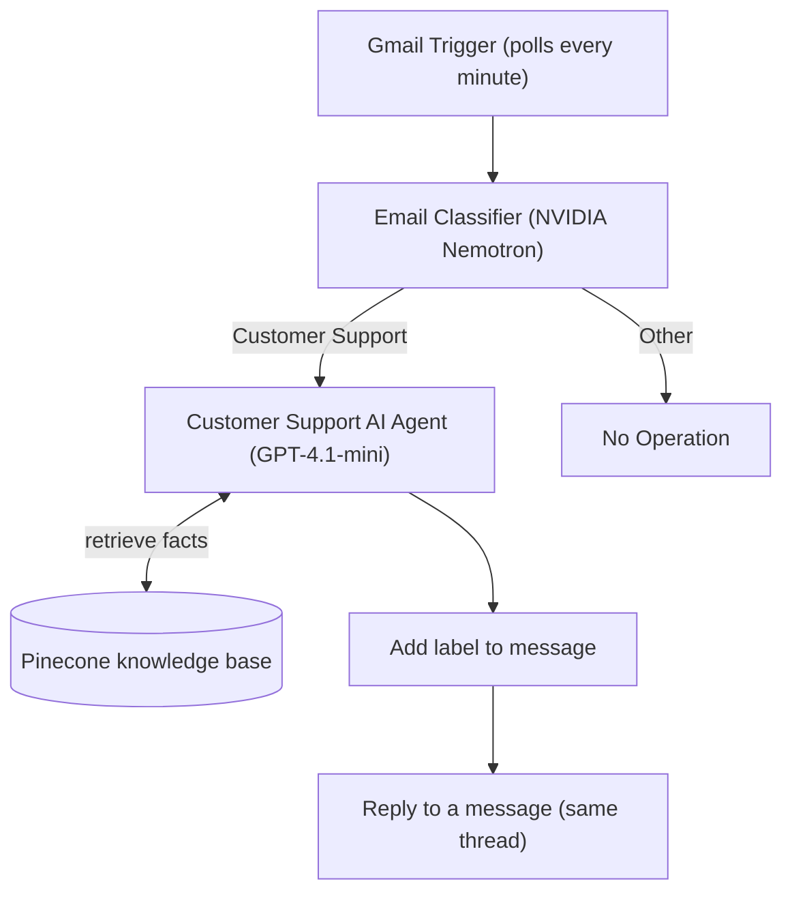
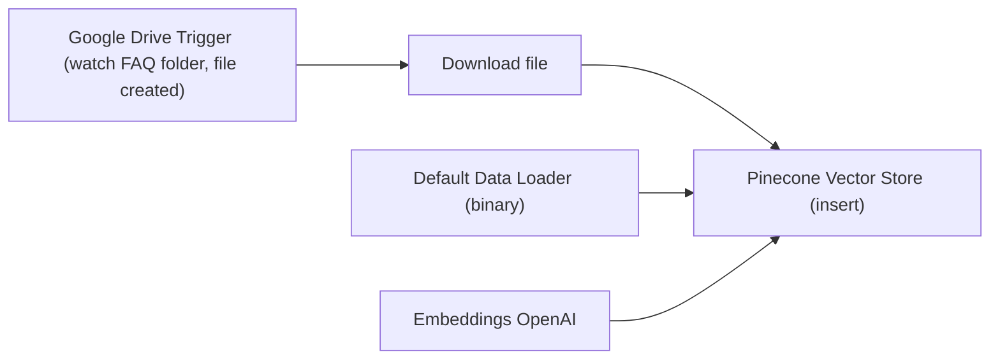

# Customer Support Chatbot (n8n)


An AI customer-support responder for **Gmail**, built entirely in [n8n](https://n8n.io). Incoming emails are classified, and customer questions about the company are answered automatically by an AI agent that **looks the facts up in a Pinecone knowledge base** (retrieval-augmented generation) before replying in the same email thread.

The knowledge base stays current on its own: drop a document into a Google Drive folder and a second flow embeds it into Pinecone.

The example is configured for a fictional company, **AI Tech (Pvt.) Ltd.**; swap in your own company details (see [Customisation](#customisation)).

## Features

- **Email triage**: a text classifier (NVIDIA Nemotron) sorts each new email into *Customer Support* or *Other*; only customer-support emails get an automatic answer.
- **Grounded answers (RAG)**: the support agent must query the Pinecone knowledge base before stating any company fact, and is instructed never to guess. If nothing relevant is found it says a team member will follow up.
- **Professional, structured replies**: greeting, acknowledgement, answer, single next step and sign-off, in plain text with no markdown.
- **Threaded reply and labelling**: the reply is sent in the original email thread and the message is tagged with a Gmail label so you can see what the bot handled.
- **Self-updating knowledge base**: a Google Drive trigger watches a folder, downloads new files and indexes them in Pinecone with OpenAI embeddings.

## Architecture

### Flow 1: answer customer emails



### Flow 2: keep the knowledge base up to date



## Workflow details

| # | Node | Type | What it does |
|---|---|---|---|
| 1 | Gmail Trigger | Gmail Trigger | Polls the mailbox every minute for new messages (no filters set) |
| 2 | Email Classifier | Text Classifier | Routes by category: **Customer Support** (anything about the company, its services or FAQs) or **Other**. Uses NVIDIA `nemotron-3-super-120b-a12b` |
| 3 | No Operation | No-Op | Receives the *Other* branch and does nothing |
| 4 | Customer Support AI Agent | AI Agent v3.1 | Reads the email text, calls the Pinecone tool and writes the reply. Uses OpenAI `gpt-4.1-mini` and a long system prompt (role, tone, tool rules, output format) |
| 5 | Pinecone Vector Store | Vector Store (retrieve-as-tool) | Knowledge-base search tool for the agent, namespace `AI Tech Company Information` |
| 6 | Add label to message | Gmail | Applies a Gmail label to the incoming message |
| 7 | Reply to a message | Gmail | Sends the agent's output as a plain-text reply in the thread (no attribution line) |
| 8 | Google Drive Trigger | Google Drive Trigger | Watches one folder for newly created files, every minute |
| 9 | Download file | Google Drive | Downloads the file as binary |
| 10 | Default Data Loader | Document Loader | Turns the binary file into documents |
| 11 | Embeddings OpenAI | Embeddings | Creates the vector embeddings (used for both indexing and search) |
| 12 | Pinecone Vector Store1 | Vector Store (insert) | Writes the embedded documents to Pinecone |
| 13-14 | NVIDIA Nemotron Chat Model, OpenAI Chat Model | Chat models | LLMs for the classifier and the agent |

## Repository structure

```
.
├── README.md
├── LICENSE
├── CREDENTIALS.md        # every credential and variable you need
├── .env.example          # template for your local .env (safe to commit)
├── .gitignore
└── workflows/
    └── customer-support-chatbot.json
```

## Tech stack

| Layer | Service / model |
|---|---|
| Orchestration | [n8n](https://n8n.io) (14 nodes, one workflow) |
| Email | Gmail (trigger, label, reply) |
| Classification | NVIDIA `nvidia/nemotron-3-super-120b-a12b` |
| Answer generation | OpenAI `gpt-4.1-mini` |
| Embeddings | OpenAI (Embeddings OpenAI node) |
| Vector database | Pinecone |
| Knowledge-base source | Google Drive |

## Prerequisites

- n8n, self-hosted or Cloud, with the **AI Agent v3.1** and **Text Classifier** nodes (update n8n if nodes appear as "unknown")
- A Pinecone index whose dimension matches your embedding model
- Accounts and keys for every service above. **See [CREDENTIALS.md](CREDENTIALS.md) for the full checklist.**

## Setup

1. **Clone the repo**
   ```bash
   git clone https://github.com/<your-username>/<repo-name>.git
   cd <repo-name>
   ```
2. **Create your `.env`** from the template and fill it in:
   ```bash
   cp .env.example .env
   ```
   Make the variables visible to n8n (for Docker add `env_file: .env` to your n8n service) and set `N8N_BLOCK_ENV_ACCESS_IN_NODE=false`.
3. **Prepare your data sources:** a Pinecone index, a Google Drive folder for knowledge-base documents, and a Gmail label for handled emails.
4. **Import the workflow:** *Workflows > Import from File* > `workflows/customer-support-chatbot.json`.
5. **Create the n8n credentials** (Gmail, Google Drive, OpenAI, NVIDIA, Pinecone) and select them on every node that shows a credential warning. The export carries only credential *references*.
6. **Load the knowledge base first.** Activate the workflow, then add your company document (PDF) to the Drive folder so Flow 2 indexes it. Confirm the vectors appear in Pinecone.
7. **Test** by sending an email with a company-related question to the connected mailbox. Do this on a test account first, because replies are sent automatically.

## Usage

| Email received | Result |
|---|---|
| "What services does your company offer?" | Classified as *Customer Support*, agent retrieves the answer from Pinecone, replies in the thread and labels the message |
| A question the knowledge base cannot answer | Agent replies that a team member will follow up, without inventing details |
| Newsletter, invoice or any unrelated email | Classified as *Other*; nothing happens |
| New file added to the Drive folder | Embedded and added to the Pinecone index |

## Customisation

- **Make it yours:** edit the *Customer Support AI Agent* system prompt. It hardcodes the company name (AI Tech (Pvt.) Ltd.), location, tone and the sign-off (`AI Tech Team` and a placeholder website).
- **Categories:** change or add categories in *Email Classifier* (for example *Sales*, *Billing*, *Spam*) and route each to its own branch.
- **Models:** swap the chat models, or the embedding model (re-index everything if you do).
- **Human review:** replace *Reply to a message* with a Gmail **Create a draft** step so a person approves each answer before sending.
- **Polling:** change the trigger interval from every minute.

## Known limitations

These were found while reviewing the export:

- **Two different Pinecone indexes.** The agent reads from one index and the Drive flow writes to another, so newly ingested documents would never be searched. Set `PINECONE_RETRIEVE_INDEX` and `PINECONE_INGEST_INDEX` to the **same** index.
- **Fixed file in *Download file*.** The node downloads one hardcoded file instead of the file that triggered the flow. To ingest each new upload, set its file ID to `{{ $json.id }}`.
- **No conversation memory.** The system prompt mentions thread memory, but no memory node is connected to the agent, so each email is handled on its own.
- **No human review.** Replies are sent automatically as soon as the agent responds.
- **No trigger filters.** The Gmail Trigger watches the whole mailbox. Add a filter (for example inbox only, or a sender or label rule) so the bot does not process or answer mail you do not intend.
- **The *Other* branch does nothing.** Non-customer emails are dropped.
- **Duplicates on re-upload.** The Pinecone node inserts; it does not remove older vectors, so re-adding a file creates duplicates.

## Security and privacy

- **Never commit secrets.** API keys live in n8n credentials; IDs live in `.env` (ignored by Git). Before pushing any new export, scan it:
  ```bash
  grep -rnE "Bearer [A-Za-z0-9]{16,}|sk-[A-Za-z0-9]{20,}|nvapi-|pcsk_|@gmail\.com" workflows/
  ```
- **Strip pinned data.** n8n exports include `pinData` (saved test executions). In this workflow it held real email headers and addresses. Clear it before every commit.
- **Prompt injection.** The agent reads untrusted email content and sends replies automatically. Keep its tools limited to retrieval, and consider the human-review option above.
- Customer emails are personal data. Use test mailboxes and fictional data for demos and follow the privacy rules that apply to you.

## Troubleshooting

| Symptom | Likely cause |
|---|---|
| `access to env vars denied` in a node | `N8N_BLOCK_ENV_ACCESS_IN_NODE` is not `false`, or the variable is not passed to the n8n container |
| Agent says it has no information | Knowledge base empty, or retrieve and ingest indexes differ (see limitations) |
| Gmail nodes return 401 or 403 | OAuth token expired, or the scopes do not include modify and send |
| Trigger never fires | Workflow not active, or the polling account is not the mailbox you are emailing |
| Pinecone dimension error | Index dimension does not match the embedding model |

## License

Released under the [MIT License](LICENSE).

This project is not affiliated with or endorsed by n8n, Google, OpenAI, NVIDIA or Pinecone.

## Author

Built by **Ammar Ilyas**, an AI automation developer focused on n8n workflows and AI agents.
