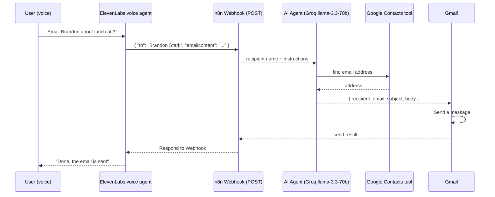

# ElevenLabs Voice Email Agent (n8n)


Ask a voice assistant to send an email and it happens. This [n8n](https://n8n.io) workflow is the **backend tool** for an [ElevenLabs](https://elevenlabs.io) voice agent: the voice agent calls a webhook with a recipient name and what to say, an AI agent finds the address in Google Contacts, writes a professional email, and Gmail sends it.

> Example: *"Send an email to Brandon Stark inviting him to lunch today at 3 PM at Monal Restaurant."*

## Features

- **Voice-triggered**: any ElevenLabs Conversational AI agent can call it through a webhook tool.
- **Name in, email out**: you give a name; the agent looks up the address instead of you dictating it.
- **Drafts professionally**: subject and body are written from your instructions and signed with your name.
- **Structured output**: the AI must return a fixed JSON shape (recipient, subject, body, status), so the Gmail node always receives clean fields.
- **Sends and confirms**: the email goes out through Gmail and the webhook responds to the caller when done.

## Architecture



## Workflow details

| # | Node | Type | What it does |
|---|---|---|---|
| 1 | Webhook | Webhook (POST) | Entry point for the ElevenLabs tool call; waits for the *Respond to Webhook* node before answering |
| 2 | AI Agent | AI Agent v3.1 | Reads `to` and `emailcontent`, uses the Contacts tool, drafts the email and signs it with your name. Output is forced into a JSON schema |
| 3 | Groq Chat Model | Chat model | `llama-3.3-70b-versatile` powers the agent |
| 4 | Google Contacts | Tool (Google Contacts) | Contact tool the agent can call |
| 5 | Structured Output Parser | Output parser | Enforces `recipient_name`, `recipient_email`, `subject`, `body`, `status` |
| 6 | Send a message | Gmail | Sends `body` to `recipient_email` with `subject` (no n8n attribution line) |
| 7 | Respond to Webhook | Respond to Webhook | Returns the Gmail result to ElevenLabs |

## Webhook contract

**Request** (`POST`, JSON body):

| Field | Type | Description |
|---|---|---|
| `to` | string | Recipient **name**, for example `Brandon Stark` |
| `emailcontent` | string | What the email should say, in plain language |

```bash
curl -X POST "https://<your-n8n-host>/webhook/<your-webhook-path>" \
  -H "Content-Type: application/json" \
  -H "X-Webhook-Token: <your-secret>" \
  -d '{"to":"Brandon Stark","emailcontent":"Invite him to lunch today at 3 PM at Monal Restaurant"}'
```

The `X-Webhook-Token` header only applies after you enable Header Auth (see [Security](#security-and-privacy)).

**Response:** the Gmail send result (message ID, thread ID, labels).

## Repository structure

```
.
├── README.md
├── LICENSE
├── CREDENTIALS.md        # every credential and variable you need
├── .env.example          # template for your local .env (safe to commit)
├── .gitignore
└── workflows/
    └── elevenlabs-voice-email-agent.json
```

## Tech stack

| Layer | Service / model |
|---|---|
| Voice interface | ElevenLabs Conversational AI (webhook tool) |
| Orchestration | [n8n](https://n8n.io) (7 nodes, one workflow) |
| LLM | Groq `llama-3.3-70b-versatile` |
| Address lookup | Google Contacts |
| Email | Gmail |

## Prerequisites

- n8n reachable at a **public HTTPS URL** (ElevenLabs must be able to reach it), with the AI Agent v3.1 node
- An ElevenLabs account with a Conversational AI agent
- Accounts and keys for the services above. **See [CREDENTIALS.md](CREDENTIALS.md) for the full checklist.**

## Setup

1. **Clone the repo**
   ```bash
   git clone https://github.com/<your-username>/<repo-name>.git
   cd <repo-name>
   ```
2. **Create your `.env`** and set `SENDER_NAME`:
   ```bash
   cp .env.example .env
   ```
   Make it visible to n8n (for Docker add `env_file: .env`) and set `N8N_BLOCK_ENV_ACCESS_IN_NODE=false`.
3. **Import the workflow:** *Workflows > Import from File* > `workflows/elevenlabs-voice-email-agent.json`.
4. **Create the n8n credentials** (Groq, Gmail, Google Contacts) and select them on every node that shows a credential warning.
5. **Set the webhook path.** Open the *Webhook* node and replace `REPLACE-WITH-A-RANDOM-UUID` with a random UUID. Add **Header Auth** with your own secret.
6. **Activate the workflow** and copy the **Production URL** of the Webhook node.
7. **Configure ElevenLabs:** on your Conversational AI agent add a webhook (server) tool with method `POST`, that URL, the secret header, and a JSON body containing `to` and `emailcontent`. Describe the tool so the agent knows to call it when you ask to send an email.
8. **Test** with the `curl` command above, using a contact that exists in Google Contacts and a test mailbox.

## Customisation

- **Tone and format:** edit the *AI Agent* system prompt (professional tone, subject and body rules).
- **Sign-off name:** change `SENDER_NAME` in `.env`.
- **Model:** swap the Groq model, or use any other chat model node.
- **Add a confirmation step:** replace *Send a message* with a Gmail **Create a draft**, or ask the voice agent to read the email back and get a "yes" before calling the webhook.

## Known limitations

- **The Contacts tool looks set up to create contacts, not search them.** Its fields (given name, family name, email) match the *Create contact* operation, so the agent may add contacts instead of finding an address. Switch the tool to **Get many** with a search query, then confirm it returns the email.
- **No fallback if a contact is not found.** The agent may guess or produce an address; the email is sent without a check.
- **No human review.** The email is sent as soon as the AI finishes.
- **Prompt and schema mismatch.** The system prompt describes `Subject` and `Body`, while the parser requires five fields (`recipient_name`, `recipient_email`, `subject`, `body`, `status`). Align them if the agent returns invalid output.
- **No conversation memory.** Each call is handled on its own.

## Security and privacy

- **Protect the webhook.** As exported, anyone who knows the URL can make your Gmail send email. Use a random path **and** enable Header Auth (a secret header that ElevenLabs sends). Never publish the production URL.
- **Never commit secrets.** API keys live in n8n credentials, values in `.env` (ignored by Git). Before pushing a new export, scan it:
  ```bash
  grep -rnE "Bearer [A-Za-z0-9]{16,}|gsk_|sk-[A-Za-z0-9]{20,}|/webhook/[0-9a-f-]{36}" workflows/
  ```
- **Strip pinned data.** n8n exports include `pinData` (saved test runs); clear it before each commit.
- **Prompt injection and misuse.** The email text comes from a voice conversation. Limit what the agent can do, and consider a confirmation step.
- Contacts and email content are personal data. Use test contacts for demos.

## Troubleshooting

| Symptom | Likely cause |
|---|---|
| ElevenLabs reports a webhook error | Workflow not active, using the *Test URL* instead of the *Production URL*, or n8n not reachable over HTTPS |
| 403 from the webhook | Header Auth enabled but the header is missing or wrong on the ElevenLabs tool |
| `access to env vars denied` | `N8N_BLOCK_ENV_ACCESS_IN_NODE` is not `false` or the variable is not passed to n8n |
| Email goes to a wrong or invented address | Contacts tool not returning a match (see limitations) |
| Agent output fails parsing | Output does not match the five-field schema |
| Gmail node returns 401 or 403 | OAuth token expired or send scope missing |

## License

Released under the [MIT License](LICENSE).

This project is not affiliated with or endorsed by n8n, ElevenLabs, Google or Groq.

## Author

Built by **Ammar Ilyas**, an AI automation developer focused on n8n workflows and AI agents.
