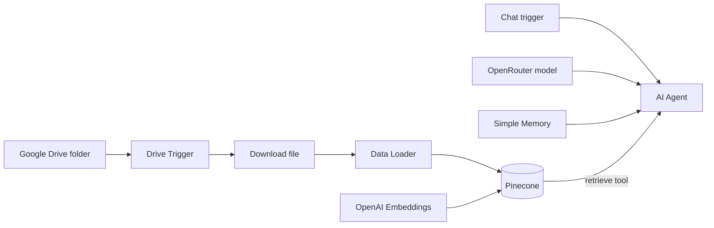

# RAG AI Assistant Chatbot (n8n)

A Retrieval-Augmented Generation (RAG) chatbot built in [n8n](https://n8n.io). Drop a recipes PDF into a Google Drive folder and it is automatically embedded into Pinecone. A chat agent then answers questions about the recipes using **only** what it retrieves from the vector store.

## How it works

The workflow has two independent pipelines.

**1. Ingestion (automatic)**
1. **Google Drive Trigger** polls a watched folder every minute for newly created files.
2. **Download file** fetches the new file as binary.
3. **Default Data Loader** converts it into documents and splits the text.
4. **Embeddings OpenAI** (1536 dimensions) turns the chunks into vectors.
5. **Pinecone Vector Store** (insert) stores them in index `n8n-14recipes-project`, namespace `14 recipes Ingredients + Methods`.

**2. Chat**
1. **When chat message received** opens the n8n chat interface.
2. **AI Agent** (OpenRouter model `nvidia/nemotron-3-super-120b-a12b`, with **Simple Memory** for conversation context) calls the **Pinecone Vector Store1** tool (top 8 matches) and answers from the retrieved text only.
3. The system prompt sets the output format: a query for a *recipe* returns ingredients plus method, *ingredients* returns the ingredient list only, and *methods* returns the steps only. Few-shot examples are included in the prompt.



## Prerequisites

- n8n (cloud or self-hosted, recent version with the LangChain nodes)
- A Pinecone index named `n8n-14recipes-project` with **1536 dimensions**
- Accounts and keys listed in [`CREDENTIALS.md`](CREDENTIALS.md): Google Drive, Pinecone, OpenAI, OpenRouter
- A recipes PDF (the original used a 14-recipe cookbook)

## Setup

1. **Clone the repo**
   ```bash
   git clone https://github.com/<your-username>/rag-ai-assistant-chatbot.git
   cd rag-ai-assistant-chatbot
   ```
2. **Prepare your secrets**
   ```bash
   cp .env.example .env
   # fill in .env with your own values (it is git-ignored)
   ```
3. **Import the workflow** in n8n: *Workflows → Import from File →* `workflows/rag-ai-assistant-chatbot.json`
4. **Create credentials** for each entry in [`CREDENTIALS.md`](CREDENTIALS.md) and attach them to the nodes.
5. **Pick your Drive folder** in the *Google Drive Trigger* node (it currently holds the placeholder `YOUR_GOOGLE_DRIVE_FOLDER_ID`).
6. **Create the Pinecone index** (1536 dimensions) if it doesn't exist, and confirm both Pinecone nodes use the same index and namespace.
7. **Activate the workflow** and upload your PDF to the watched folder. Wait about a minute for ingestion.
8. **Open the chat** and ask, for example: *"Tell me the recipe for Classic Hummus"*.

> n8n stores credentials encrypted in its own database and does not auto-load `.env` into node credentials. Use `.env` as your local secret reference, enter the values through the n8n UI, or expose them as environment variables for your n8n instance.

## Repository structure

```
.
├── workflows/
│   └── rag-ai-assistant-chatbot.json   # sanitized n8n export
├── .env.example                        # variable template (safe to commit)
├── CREDENTIALS.md                      # every credential and placeholder required
├── .gitignore
├── LICENSE
└── README.md
```

## Security

- The workflow JSON was **sanitized**: credential IDs, instance ID, webhook ID, the Drive folder ID, and pinned test data (which contained a personal email, Drive file IDs and share links) were removed or replaced with placeholders.
- Never commit `.env` or a raw n8n export. Sanitize any re-export before committing.
- If a real key was ever committed or shared publicly, revoke and rotate it.

## Known limitations

- The trigger fires on every new file, so uploading the same document twice stores duplicate vectors.
- The data loader uses default text splitting. For better retrieval you can attach a Recursive Character Text Splitter and tune chunk size and overlap.
- The agent has no fallback message for questions the knowledge base can't answer beyond the prompt's "only use retrieved data" rule.
- The chat model is a third-party hosted model on OpenRouter; check its availability and rate limits.

## License

Released under the [MIT License](LICENSE).
