# RydFlow Content Generation (Veo 3) - n8n

An end-to-end n8n workflow that turns one click into a finished set of short-form marketing video clips. It writes a sitcom-style ad script for **RydFlow** (an AI CRM and booking engine for coach, limo and ground transportation), splits it into four ~8-second scenes, generates image and video prompts, creates character-consistent images, and animates each image into a 9:16 video clip with Veo 3. Every step is logged to Google Sheets.

## Pipeline

| Stage | What happens | Tools |
|---|---|---|
| 1. Context | Reads rows with `Status = Generated` from the sheet and aggregates earlier scripts so new ones don't repeat | Google Sheets, Set, Aggregate |
| 2. Script | `Script Writer Agent` writes a 75-85 word, 32-second sitcom script (hook, problem, solution, win, CTA) | OpenAI `gpt-4.1`, Think tool, structured parser |
| 3. Scenes | `Beats/Scene Agent` splits the script into 4 beats of ~8 seconds | OpenAI `gpt-4.1` |
| 4. Image prompts | `Image Prompt Generation Agent` writes 4 flattened, photorealistic YAML-style prompts | OpenAI `gpt-4.1` |
| 5. Video prompts | `Video Prompt Generation Agent1` writes 4 Veo-style prompts (camera, timeline, audio, lighting) | OpenAI `gpt-4.1` |
| 6. Images | 4 parallel branches call Kie.ai `bytedance/seedream-v4-edit` with the prompt plus 7 character reference images, poll every 15 s until `success`, save the URL to the sheet | Kie.ai, Wait, If |
| 7. Re-host | Each image is downloaded and uploaded to Cloudinary for a stable public URL | Cloudinary |
| 8. Videos | 4 parallel branches call Kie.ai `veo3_lite` (image-to-video, 9:16), poll until done, save the video URL. Branch 4 sets `Status = Generated` | Kie.ai, Wait, If |

```mermaid
flowchart LR
  T[Manual trigger] --> G[Get previous scripts] --> A[Aggregate] --> S[Script agent]
  S --> B[Scene agent] --> L1[(Sheet: script + scenes)]
  L1 --> IP[Image prompt agent] --> L2[(Sheet: image prompts)]
  L2 --> VP[Video prompt agent] --> L3[(Sheet: video prompts)]
  L3 --> I[4x Seedream images] --> C[Cloudinary] --> V[4x Veo 3 videos] --> L4[(Sheet: URLs + Generated)]
```



## Google Sheet layout

Create a sheet (tab `Sheet1`) with these exact column headers:

`Scripts`, `Scene-1`, `Scene-2`, `Scene-3`, `Scene-4`, `Image Prompt 1`-`4`, `Image URL (1)`-`(4)`, `Video Prompt 1`-`4`, `Video URL (1)`-`(4)`, `Status`

Rows are created with `Status = Pending` and the update nodes find the row by matching the `Scripts` column.

## Prerequisites

- n8n with the LangChain nodes and the community node **`n8n-nodes-cloudinary`**
- Accounts and keys listed in [`CREDENTIALS.md`](CREDENTIALS.md): OpenAI, Kie.ai, Cloudinary, Google Sheets
- 7 character reference photos uploaded to Cloudinary (names in `CREDENTIALS.md`)

## Setup

1. **Clone the repo**
   ```bash
   git clone https://github.com/<your-username>/rydflow-content-generation.git
   cd rydflow-content-generation
   ```
2. **Prepare your secrets**
   ```bash
   cp .env.example .env
   # fill in .env with your own values (it is git-ignored)
   ```
3. **Import** `workflows/rydflow-content-generation-veo3.json` in n8n (*Workflows → Import from File*).
4. **Create the four credentials** in [`CREDENTIALS.md`](CREDENTIALS.md) and attach them to the nodes.
5. **Create the Google Sheet** and re-select it in every Google Sheets node (the placeholder is `YOUR_GOOGLE_SHEET_ID`).
6. **Replace `YOUR_CLOUD_NAME`** in the four *Image N Generation* nodes with your Cloudinary cloud name.
7. **Test in stages.** Disable the image and video branches first and confirm the script, scenes and prompts log correctly before spending image and video credits.
8. Click **Execute workflow** to run it.

> n8n stores credentials encrypted in its own database and does not auto-load `.env` into node credentials. Use `.env` as a local reference, enter values through the n8n UI, or expose them as environment variables for your n8n instance.

## Repository structure

```
.
├── workflows/
│   └── rydflow-content-generation-veo3.json   # sanitized n8n export
├── .env.example                               # variable template (safe to commit)
├── CREDENTIALS.md                             # credentials, placeholders, reference images
├── .gitignore
├── LICENSE
└── README.md
```

## Security

- The workflow JSON was **sanitized**: credential IDs, instance ID, webhook IDs, the Google Sheet ID and the Cloudinary cloud name were removed or replaced with placeholders.
- The prompts contain RydFlow product positioning and character descriptions. Consider a **private repository** if that is not meant to be public.
- Never commit `.env`, a raw n8n export, or generated media. Revoke and rotate any key that was ever exposed.

## Known issues

These come from reviewing the exported workflow:

- **Invalid expression:** `Image Prompt Generation Agent` uses `$(Beat/Scene)`, which is not valid (node names must be quoted, and no node has that name). The agent's input likely should be `$json['Scene-1']` etc. from the previous node or `$('Beats/Scene Agent').item.json.output.scene1`.
- **Wait nodes 5, 6, 7** have no duration set, so n8n's default (1 hour) applies. `Wait4` uses 2 minutes; set the others to match.
- **Polling loops never stop.** Each `If` only checks for success; a failed Kie.ai job loops forever. Add a max-attempts counter and a failure branch.
- **Inconsistent success checks:** video branches 1-3 use `successFlag >= 1` while branch 4 uses `== 1`; confirm which values mean failure in the Kie.ai docs.
- **Parallel updates to one row** (matched on the `Scripts` text) can race. A row ID column would be safer.
- **Image 1** sends `seed: 9500` and `nsfw_checker`; Images 2-4 do not. Make them consistent if intended.
- The in-canvas setup note says to connect *Merge Scripts → Script Writer Agent*; that connection already exists. The flow note also mentions a `Wait8` node that doesn't exist.
- Only rows with `Status = Generated` count as "previous scripts", so a run that fails before Video 4 finishes is not remembered and its idea may be repeated.
- The branch 4 node `Download Image ` has a trailing space in its name (harmless, but easy to trip over).

## License

Released under the [MIT License](LICENSE).
