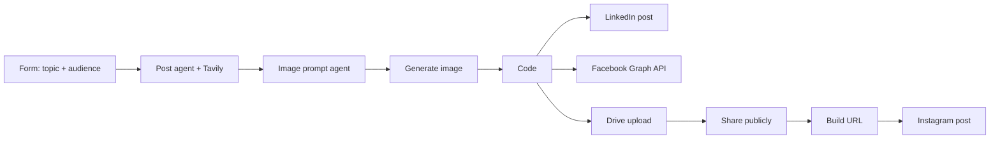

# Ultimate Social Media Posting Agent (n8n)

An n8n workflow that turns a short web form into a published social media post. Enter a **topic** and a **target audience**; an AI agent researches the topic live, writes the post, another agent designs a matching image prompt, an image is generated, and the finished post is published to **LinkedIn, Facebook and Instagram**.

## How it works

1. **On form submission** collects `Topic of Post` and `Target Audience` (both required).
2. **Social Media Post Agent** (OpenAI `gpt-4o`) searches the web with **Tavily**, then writes a professional post with a hook, source attributions, light emoji use, hashtags and a call to action. Its output is the post text only.
3. **Image Prompt Agent** (same model) turns the post into a marketing-style text-to-image prompt.
4. **Generate an image** (OpenAI `gpt-image-1-mini`, medium quality, 1024x1024) creates the graphic as binary data.
5. **Code in JavaScript** validates the binary and passes it on (it also builds a base64 data URI that the later steps do not use).
6. The image then fans out to three parallel branches:
   - **LinkedIn:** *Create a post* publishes the text and image publicly.
   - **Facebook:** *Facebook Graph API* uploads the file to the Page's `photos` edge with the post as caption.
   - **Instagram:** *Upload file* (Google Drive) → *Share file* (public link) → *Code in JavaScript1* (builds a direct-view URL) → *Post on Instagram*, because Instagram needs a public image URL.



## Prerequisites

- n8n with the LangChain nodes and the community nodes **`@tavily/n8n-nodes-tavily`** and **`@mookielianhd/n8n-nodes-instagram`**
- Accounts and tokens listed in [`CREDENTIALS.md`](CREDENTIALS.md): OpenAI, Tavily, LinkedIn, Google Drive, Instagram Business, Facebook Page

## Setup

1. **Clone the repo**
   ```bash
   git clone https://github.com/<your-username>/social-media-posting-agent.git
   cd social-media-posting-agent
   ```
2. **Prepare your secrets**
   ```bash
   cp .env.example .env
   # fill in .env with your own values (it is git-ignored)
   ```
3. **Import** `workflows/social-media-posting-agent.json` in n8n (*Workflows → Import from File*).
4. **Create the credentials** in [`CREDENTIALS.md`](CREDENTIALS.md) and attach them to the nodes.
5. **Replace the placeholders:** `YOUR_LINKEDIN_PERSON_ID` (LinkedIn node) and `YOUR_INSTAGRAM_BUSINESS_ACCOUNT_ID` (Instagram node).
6. **Test each branch on its own** (LinkedIn, Facebook, Instagram), ideally on test accounts, before running end to end.
7. Open the form's test URL, submit a topic, then activate the workflow once all three branches work.

> n8n stores credentials encrypted in its own database and does not auto-load `.env` into node credentials. Use `.env` as a local reference, enter values through the n8n UI, or expose them as environment variables for your n8n instance.

## Repository structure

```
.
├── workflows/
│   └── social-media-posting-agent.json   # sanitized n8n export
├── .env.example                          # variable template (safe to commit)
├── CREDENTIALS.md                        # credentials, placeholders, permissions
├── .gitignore
├── LICENSE
└── README.md
```

## Security

- The workflow JSON was **sanitized**: credential IDs, instance ID, webhook IDs, the LinkedIn author ID and the Instagram Business Account ID were removed or replaced with placeholders.
- Never commit `.env`, tokens, or a raw n8n export. Revoke and rotate any token that was ever exposed.
- This workflow **publishes publicly and automatically** to real accounts. Test with sandbox accounts first.

## Known issues and risks

- **Public Drive files:** *Share file* makes the image readable by **anyone** with `allowFileDiscovery: true` (discoverable), and the file is uploaded to Drive root and never deleted. Set discovery to `false`, upload to a dedicated folder, and delete the file after Instagram has published.
- **No human review:** posts go live straight after generation. Add an approval step (for example a Slack or email confirmation with a Wait node) if the content must be checked first.
- **Instagram image URL:** the `drive.google.com/uc?export=view` link can fail for Instagram's fetcher. A dedicated host (Cloudinary, S3 or similar) is more reliable.
- **Unused data URI:** *Code in JavaScript* builds a large base64 string that nothing uses; it only needs to pass the binary through (or can be removed).
- **No length checks:** LinkedIn (3,000 chars) and Instagram (2,200 chars, 30 hashtags max) have limits that the agent is not told about.
- **No error handling:** the three branches run in parallel; if one fails you are not notified and the others still publish.
- **AI-written claims:** the post relies on a model plus search; facts and source attributions should be verified before publishing.
- Cosmetic: the form title reads "Social Media Post Post Generator".

## License

Released under the [MIT License](LICENSE).
