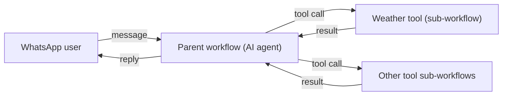
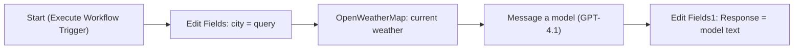

# WhatsApp AI Assistant (n8n)


An AI-powered WhatsApp assistant built entirely in [n8n](https://n8n.io). A **parent workflow** receives WhatsApp messages and runs an AI agent. The agent calls **sub-workflows as tools** whenever it needs to do something specialised, such as fetching live weather, and then replies to the user on WhatsApp.

Each workflow lives in its own folder as an importable n8n JSON export, so you can use the whole assistant or lift out a single tool for your own projects.

---

## How it works



1. A user sends a message on WhatsApp.
2. The parent workflow passes it to an AI agent.
3. If the request needs a capability the agent doesn't have natively (e.g. weather), it calls the matching sub-workflow as a tool.
4. The sub-workflow does its job and returns a result to the agent.
5. The agent composes the final answer and sends it back to the user.

---

## Repository structure

```
.
├── README.md
├── LICENSE
├── .gitignore
├── parent-workflow/          # WhatsApp entry point + AI agent
│   └── workflow.json
├── weather-tool/             # Sub-workflow tool: current weather for a city
│   └── workflow.json
└── <next-tool>/              # One folder per additional sub-workflow
    └── workflow.json
```

| Folder | Workflow | Role |
|---|---|---|
| `parent-workflow/` | Parent workflow | Receives WhatsApp messages, runs the AI agent, calls the tools below, sends the reply |
| `weather-tool/` | Child Workflow for Weather | Tool: looks up live weather for a city and returns a funny, emoji-filled summary |

<!-- TODO: add one row per additional sub-workflow tool -->

---

## Workflow details

### Parent workflow

<!-- TODO: describe the trigger (WhatsApp webhook), the AI agent node, model, memory, and the list of tools it can call -->

Receives incoming WhatsApp messages, runs the AI agent, and exposes the sub-workflows in this repo to the agent as tools.

---

### Weather tool (`weather-tool/`)

**Workflow name in n8n:** `Child Workflow for Weather`

**Purpose:** Given a city name, fetch the current weather from OpenWeatherMap and have GPT-4.1 turn the raw data into a short, funny, emoji-rich message that the parent agent can relay to the user.

**Input** (from the parent agent's tool call)

| Field | Type | Description |
|---|---|---|
| `query` | string | City name, e.g. `Rawalpindi` |

**Output**

| Field | Type | Description |
|---|---|---|
| `Response` | string | The generated weather message |

**Flow**



**Nodes**

| # | Node | Type | What it does |
|---|---|---|---|
| 1 | Start | Execute Workflow Trigger | Entry point when called by the parent. Input source is *passthrough*, so it accepts whatever the parent sends. |
| 2 | Edit Fields | Set | Maps the incoming `query` to a `city` field. |
| 3 | OpenWeatherMap | OpenWeatherMap | Fetches current weather for `city`. Uses the node's default units. |
| 4 | Message a model | OpenAI (GPT-4.1) | Receives the weather fields (main condition, description, temperature, feels-like, humidity, country, city). A system prompt makes it act as a weather assistant that replies in a funny tone with emojis. |
| 5 | Edit Fields1 | Set | Extracts the model's text into a single `Response` field, which is returned to the caller. |

**Settings of note:** execution order `v1`; caller policy `workflowsFromSameOwner` (only workflows from the same owner can call it); not exposed to MCP.

**Credentials used:** OpenWeatherMap API, OpenAI API.

---

<!-- TODO: add a section like the one above for each additional sub-workflow tool -->

## Tech stack

- [n8n](https://n8n.io) (self-hosted or n8n Cloud)
- [OpenAI](https://platform.openai.com) (GPT-4.1)
- [OpenWeatherMap API](https://openweathermap.org/api)
- WhatsApp messaging channel (configured in the parent workflow)

---

## Prerequisites

- An n8n instance (self-hosted or Cloud)
- An OpenAI API key
- An OpenWeatherMap API key (the free tier is enough for current weather)
- WhatsApp credentials for the parent workflow's trigger and send nodes

---

## Setup

1. **Clone the repo**
   ```bash
   git clone https://github.com/<your-username>/<repo-name>.git
   cd <repo-name>
   ```

2. **Import the workflows** in n8n via *Workflows → Import from File*. Import the **sub-workflows first**, then the parent workflow.

3. **Create your credentials** in n8n (*Credentials → Create*) for OpenAI, OpenWeatherMap and WhatsApp.
   The exported JSON files contain only credential *references* (an ID and a name), never the secrets themselves. After importing, open each node that shows a credential warning and select your own credential.

4. **Re-link the tools in the parent workflow.** Workflow IDs are different on every n8n instance, so open each tool node in the parent agent and re-select the imported sub-workflow.

5. **Activate** the sub-workflows and the parent workflow.

6. **Test it.** Send a WhatsApp message such as *"What's the weather in Islamabad?"* and the agent should call the weather tool and reply.

To test the weather tool on its own, run it manually from the n8n editor with this input:

```json
{ "query": "Islamabad" }
```

---

## Customising the weather tool

- **Tone:** edit the system message in the *Message a model* node. It is currently set to funny with emojis. Change it to professional or concise if you prefer.
- **Model:** swap GPT-4.1 for any other model available in the OpenAI node.
- **Units:** set the units option on the *OpenWeatherMap* node (metric / imperial).

---

## Known limitations

- **No error handling in the weather tool yet.** If a city isn't found, the OpenWeatherMap node errors and the failure propagates to the parent agent.
- **Fixed response path.** The final node reads `$json.output[0].content[0].text`, which assumes the OpenAI node's current response shape.
- **No input validation.** An empty `query` is passed straight through to OpenWeatherMap.

---

## Security

- Never commit API keys, `.env` files or credential exports. The included `.gitignore` blocks the common ones, but always review a workflow export before committing it.
- Exports include metadata such as your n8n instance ID and credential names. Remove them if you want a fully anonymous export.

---

## License

Released under the [MIT License](LICENSE).

## Author

**Ammar Ilyas**, AI automation and n8n workflow developer, Rawalpindi, Pakistan.

