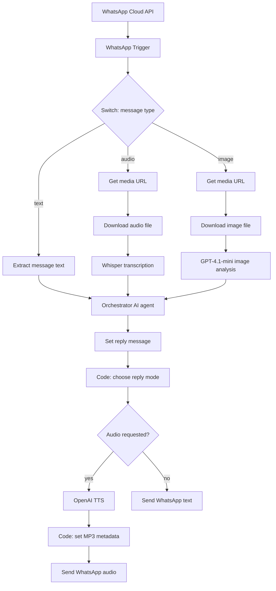
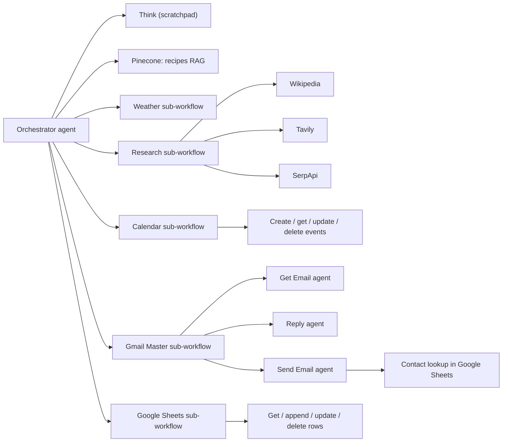

# WhatsApp AI Assistant: Multi-Agent Workflow Suite for n8n


A multimodal WhatsApp assistant built entirely in [n8n](https://n8n.io). It understands **text, voice notes and images**, decides which specialist to call, and replies in **text or voice**.

One parent workflow acts as the orchestrator. Five sub-workflows (each with its own agent and tools) are exposed to it as tools, so the main agent stays small while every specialist can be developed, tested and swapped independently.

## Features

- **Multimodal input**: typed messages, voice notes (Whisper transcription) and photos (GPT-4.1-mini vision analysis).
- **Text or voice replies**: replies are text by default; if the user asks for audio ("reply in voice", "read that out"), the answer is converted to a voice note with OpenAI TTS.
- **Tool-using orchestrator agent** with a Think scratchpad, automatic fallback to a second LLM, and per-contact conversation memory (last 10 messages).
- **Recipe Q&A (RAG)** over a Pinecone vector store.
- **Live research**: Wikipedia, Tavily and Google (SerpApi) combined by a research agent.
- **Weather** with a short, friendly, emoji-rich summary.
- **Google Calendar**: check schedule, create, update and delete events in plain language.
- **Gmail**: find and summarise emails, reply to an email, or compose and send a new one (recipient resolved from a Google Sheet).
- **Employee records** in Google Sheets: look up, add, update and delete rows by chatting.

## Architecture

### Message flow (parent workflow)



### Agent and tool map



## Repository structure

Each workflow lives in its own folder, so it can be imported, documented and versioned on its own. Folder `01-` is the parent; folders `02-` to `06-` are the sub-workflows it calls as tools.

```text
.
├── README.md
├── LICENSE
├── .gitignore
├── 01-whatsapp-ai-assistant-parent/
│   └── whatsapp-ai-assistant-chatbot.json
├── 02-weather-agent/
│   └── weather-agent.json
├── 03-research-agent/
│   └── research-agent.json
├── 04-calendar-agent/
│   └── calendar-agent.json
├── 05-gmail-master-tool/
│   └── gmail-master-tool.json
└── 06-google-sheets-agent/
    └── google-sheets-agent-employee-records.json
```

## What each workflow does

| Workflow | File | Role | LLM | Tools / APIs |
|---|---|---|---|---|
| **WhatsApp AI Assistant Chatbot** (parent) | `01-whatsapp-ai-assistant-parent/whatsapp-ai-assistant-chatbot.json` | Receives messages, normalises text/voice/image into text, runs the orchestrator agent, returns text or audio | NVIDIA Nemotron 3 Super (primary), Groq `openai/gpt-oss-20b` (fallback); GPT-4.1-mini for vision | WhatsApp Cloud API, OpenAI (Whisper, vision, TTS), Pinecone, Think |
| **Weather** | `02-weather-agent/weather-agent.json` | Cleans the city name, fetches current conditions, rewrites them as a friendly WhatsApp message | GPT-4.1 | OpenWeatherMap |
| **Research Agent** | `03-research-agent/research-agent.json` | Chooses between encyclopedic, synthesised and real-time sources and returns a concise answer | GPT-5.1 | Wikipedia, Tavily, SerpApi |
| **Calendar AI Agent** | `04-calendar-agent/calendar-agent.json` | Natural-language calendar management | Groq `llama-3.3-70b-versatile` | Google Calendar (create, get, update, delete) |
| **Gmail Master Tool** | `05-gmail-master-tool/gmail-master-tool.json` | Router agent that delegates to Get Email, Reply and Send Email agents, each with its own drafting helper | GPT-4.1-mini | Gmail, Google Sheets (contact lookup) |
| **Google Sheets Agent (Employee Records)** | `06-google-sheets-agent/google-sheets-agent-employee-records.json` | Manages an employee spreadsheet | Groq `llama-3.3-70b-versatile` | Google Sheets (get, append, update, delete) |

### Parent workflow in detail

1. **Trigger and routing**: the WhatsApp Trigger listens for `messages`. A Switch node routes on the message type (`text`, `audio`, `image`).
2. **Normalisation**: text is extracted directly; voice notes are downloaded and transcribed with Whisper; images are downloaded and described by a vision model. All three branches produce a single `text` field.
3. **Orchestrator agent**: the system prompt makes the agent call **Think** before every action, pick the right tool, and relay sub-workflow answers without rewording them or leaking raw JSON. It formats for WhatsApp (`*bold*`, no markdown headers).
4. **Reply mode**: a Code node scans the user's request for audio phrases (for example "voice note", "reply in voice", "read that out"). If matched, the reply goes through OpenAI TTS (voice: `onyx`) and is sent as an MP3 voice note; otherwise it is sent as text.

### Sub-workflow contract

Every sub-workflow starts with an **Execute Workflow Trigger** (passthrough) and receives a single natural-language field, `query`. The parent's *Call n8n Workflow Tool* nodes describe to the orchestrator when each one should be used.

## Prerequisites

- **n8n** (self-hosted or Cloud), a recent release. The workflows use the AI Agent node v3.1 and the OpenAI node v2.3; if nodes appear as "unknown" after import, update n8n.
- **Community nodes** (install from *Settings > Community Nodes*):
  - `@tavily/n8n-nodes-tavily`
  - `n8n-nodes-serpapi`
  - On self-hosted n8n, set `N8N_COMMUNITY_PACKAGES_ALLOW_TOOL_USAGE=true` so community nodes can be used as AI tools.
- A **Meta developer app** with the WhatsApp Business Cloud API product, a phone number, and an n8n instance reachable over HTTPS so WhatsApp can deliver webhooks.
- Accounts and API keys for the services below.

### Credentials to create in n8n

| Credential | Used in | Purpose |
|---|---|---|
| WhatsApp Business Cloud (OAuth, for the trigger) | Parent | Receive messages |
| WhatsApp Business Cloud (API token) | Parent | Send messages, fetch media |
| OpenAI | Parent, Weather, Research, Gmail | Whisper, vision, TTS, drafting and research agents |
| NVIDIA | Parent | Primary chat model for the orchestrator |
| Groq | Parent, Calendar, Google Sheets | Fallback model and sub-agent models |
| OpenRouter | Parent | Optional chat model (research agent copy on the parent canvas) |
| Pinecone | Parent | Recipe vector store |
| Tavily | Research | Web research and synthesis |
| SerpApi | Research | Real-time Google results |
| OpenWeatherMap | Weather | Current conditions |
| Google Calendar OAuth2 | Calendar | Needs write access, not just read |
| Google Sheets OAuth2 | Google Sheets, Gmail | Employee records and contact lookup |
| Gmail OAuth2 | Gmail | Needs read and send scopes |

> Exported workflows contain only credential **names and IDs**, never the secrets themselves. You must recreate each credential in your own n8n instance and re-select it on the nodes.

## Setup

1. **Import the sub-workflows first.** In n8n choose *Workflows > Import from file* for the JSON file in each of the folders `02-` to `06-`.
2. **Import the parent** from `01-whatsapp-ai-assistant-parent/`.
3. **Re-link the sub-workflow tools.** The parent stores the n8n IDs of the original sub-workflows, which will not exist in your instance. Open each of the five *Call n8n Workflow Tool* nodes (Weather, Research, Calendar, Gmail Master, Google Sheets) and select the matching imported workflow from the list.
4. **Attach credentials** on every node that shows a credential warning.
5. **Replace environment-specific values** (see the table below).
6. **Prepare your data sources**: the Employee Records sheet and the Pinecone index (see below).
7. **Connect WhatsApp**: configure the trigger with your Meta app credentials, then **activate** the parent workflow so the production webhook is registered.
8. Send a message to your WhatsApp number and watch the execution in n8n.

### Values you must change

| What | Where |
|---|---|
| WhatsApp Phone Number ID | `Send message` and `Send message1` nodes (parent) |
| Calendar ID / email | The four Google Calendar nodes in the Calendar sub-workflow |
| Employee Records spreadsheet | Four Google Sheets nodes in the Sheets sub-workflow, plus the contact-lookup node in the Gmail sub-workflow |
| Pinecone index name | `Pinecone Vector Store` node (parent) |
| Sub-workflow selection | The five *Call n8n Workflow Tool* nodes (parent) |

### Employee Records sheet

Create a Google Sheet with one tab (`Sheet1`) and this header row, **spelled exactly like this** because the workflows match on it:

| Emplyee ID | Name | Age | Department | Email | Contact |
|---|---|---|---|---|---|

`Emplyee ID` is intentionally spelled as in the original sheet. If you correct the typo, update the column mapping in the Append and Update nodes and the matching column in the Update node.

### Pinecone recipe index

The orchestrator queries a Pinecone index (`14-recipes-rag-agent` in the original build) through OpenAI embeddings. This repository does not include an ingestion workflow, so you need to load your own recipe documents into the index, using the **same embedding model** that the `Embeddings OpenAI` node uses at query time.

## Usage examples

| Say this on WhatsApp | Handled by |
|---|---|
| "What's the weather in Karachi?" | Weather sub-workflow |
| "Who won the match today?" / "Current price of gold" | Research sub-workflow |
| "Give me a recipe using chickpeas" | Pinecone recipe tool |
| "Book a meeting with the team tomorrow at 5 PM" | Calendar sub-workflow |
| "Do I have an email from HR?" | Gmail sub-workflow (Get Email agent) |
| "Reply to Ali's email saying yes" | Gmail sub-workflow (Reply agent) |
| "Send an email to Sara about tomorrow's meeting" | Gmail sub-workflow (Send Email agent) |
| "What's Ahmed's department?" / "Add a new employee..." | Google Sheets sub-workflow |
| A voice note, or a photo with a question | Whisper / vision, then the orchestrator |
| "...and reply in voice" | Reply is returned as a voice note |

## Customisation

- **Swap models**: each agent has its own chat-model node. Change it there without touching the rest of the workflow.
- **Add a specialist**: build a new sub-workflow with an Execute Workflow Trigger that takes `query`, then add it to the parent as a *Call n8n Workflow Tool* and describe it in the orchestrator's system prompt.
- **Change the voice**: edit the `voice` parameter on the `Generate audio` node.
- **Tune audio triggers**: edit the `audioKeywords` regex in the `Code in JavaScript1` node.

## Security and privacy

- **Never commit secrets.** Before pushing an export, search it for tokens, for example:
  ```bash
  grep -rnE "Bearer |EAA[A-Za-z0-9]{20,}|sk-[A-Za-z0-9]{20,}|gsk_|tvly-" --include="*.json" .
  ```
  HTTP Request nodes that call WhatsApp media URLs should authenticate through the WhatsApp credential, not a manually typed `Authorization` header.
- If a token has ever been pasted into a workflow, a chat, or a commit, **revoke and regenerate it**; removing it from the latest commit does not remove it from Git history.
- Exports can also contain personal identifiers (email addresses, spreadsheet IDs, phone number IDs). Replace them with placeholders in a public repository.
- The Sheets agent can **delete rows** and the Calendar agent can **delete events**; the Gmail agent can **send email** on the user's behalf. Restrict who can message the bot and consider adding a confirmation step before destructive actions.
- Employee records are personal data. Use fictional data for demos and follow the privacy rules that apply to you.

## Known limitations

- Only text, voice notes and images are handled; other WhatsApp message types (stickers, documents, locations) are ignored.
- Audio replies are triggered by phrases in the user's request. A voice note on its own gets a text reply unless the transcription contains one of those phrases.
- For images, only the vision model's description reaches the agent; the user's caption is not forwarded.
- Row deletion in Google Sheets is positional (start row and count), so it relies on the agent identifying the correct row first.

## Troubleshooting

| Symptom | Likely cause |
|---|---|
| "Workflow not found" on a tool node | The tool still points at an ID from the original instance; re-select the sub-workflow |
| Tavily or SerpApi nodes show as unknown | Community nodes not installed |
| Sub-workflow cannot be called | Sub-workflows only accept calls from workflows with the same owner; import everything under the same n8n user or project |
| No reply on WhatsApp | Workflow not active, webhook not registered, or n8n not reachable over HTTPS |
| Google nodes return 401 | OAuth token expired; re-authorise the credential |
| Recipe tool returns nothing | Index is empty or ingestion used a different embedding model |

## Roadmap ideas

- Confirmation step before deleting data or sending email.
- Error-handling workflow with a fallback WhatsApp message.
- Ingestion workflow for the recipe index.
- Support for documents and locations.

## License

Released under the [MIT License](LICENSE).

This project is not affiliated with or endorsed by Meta, WhatsApp, n8n or any of the other services it integrates with.

## Author

Built by **Ammar Ilyas**, an AI automation developer focused on n8n workflows, AI agents and CRM automation.
